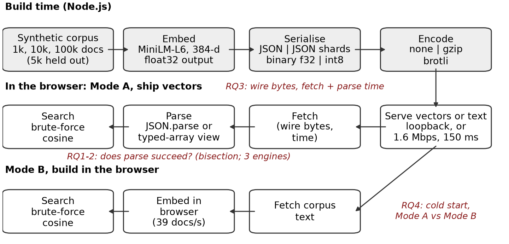
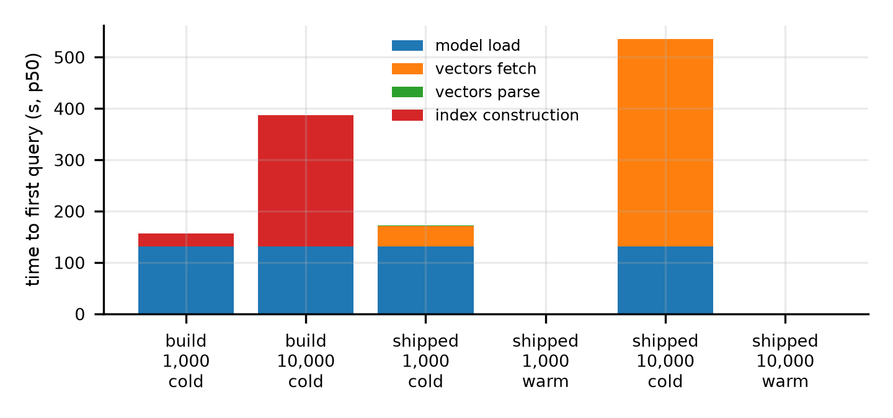

# A Serialisation Ceiling in Browser-Native Semantic Retrieval

[](https://github.com/roshanaryal1/serialisation-ceiling-artifact/actions/workflows/ci.yml)
[](LICENSE)
[](LICENSE-DATA)

Research artifact for **"A Serialisation Ceiling in Browser-Native Semantic
Retrieval: Mechanism, Prediction, and Remedy"** by Roshan Aryal: the browser
harness, corpus generator, raw run records, pre-registrations and analysis code.

| | |
|---|---|
| Venue | 4th International Conference on Smart Sustainable Development (SSD 2026), Auckland. Accepted; proceedings to be published by Atlantis Press (Springer Nature) |
| Status | Camera-ready submitted 10 November 2026. The manuscript is not included here; cite the proceedings version once published |
| Release | `v1.0.0` matches the camera-ready |

## The finding in one paragraph

Browser-native semantic search usually ships precomputed vectors to the browser
as one JSON file. In Chromium/V8 that pattern fails between **61,000 and
67,000 documents**, because the JSON text exceeds the engine's maximum string
length (536,870,888 characters), not because the device runs out of memory.
The boundary is predictable as `string limit ÷ bytes per document` (66,434).
Sharding the JSON removes the failure but keeps the parse cost; a binary
`Float32Array` artifact removes both and is 5.19× smaller uncompressed
(2.35× smaller than Brotli-compressed JSON).



*Figure 1 of the paper: build-time variables, the two deployment modes, and where
each research question is answered.*

## Headline results

| Result | Value | Where |
|---|---|---|
| Chromium/V8 boundary (bisection) | 61,000 works, 67,000 fails | `research/results/ceiling_probe.json` |
| Predicted boundary | 66,434 documents | `research/results/string_limit_probe.json` |
| Fetch + parse at 10,000 documents | JSON 200.3 ms [196.1, 206.9]; Float32 binary 20.7 ms [19.9, 21.5]. Point values are the sum of per-stage medians, as reported in the paper; brackets are the 95% bootstrap CI of the median per-run total | `research/analysis/serialization_total_ci.py` |
| Remedy arms at 100,000 documents | monolithic JSON 0/20; sharded JSON 20/20; binary 20/20 | `research/analysis/serialization_remedy_summary.py` |
| Firefox / WebKit, 110,000-document probe | both parse it, as their higher limits predict | `research/results/ceiling_probe_{firefox,webkit}.json` |



*Figure 2 of the paper: Chromium cold start by component on a 1.6 Mbps throttled
profile. Transfer of the vectors artifact dominates at 10,000 documents.*

Retrieval quality is deliberately **not** reported: the pre-registered
relevance-judgement reliability threshold failed (Cohen's kappa 0.512 against
a 0.70 bar; see `research/queries/ADJUDICATION_OUTCOME.md`).

## Reproduce

The two checks below run in CI on every push and need only Python's standard
library and the committed data:

```sh
python3 research/analysis/serialization_total_ci.py      # Section 5.2 medians and CIs
python3 research/analysis/serialization_remedy_summary.py # the five pre-registered predictions
```

Full re-measurement needs the browser harness:

```sh
npm install                                  # transformers.js and Playwright, pinned
python3 -m venv research/.venv && research/.venv/bin/pip install -r research/requirements.lock.txt
bash research/analysis/run_all.sh            # regenerate the results tables and figures
python3 research/analysis/make_design_figure.py   # the study-design figure
```

Large artifacts (corpora, vectors, model mirror) are not committed; regenerate
them as described in `research/harness/RUNBOOK.md` and check them against
`research/PROVENANCE.md`. The main matrix was measured on an Apple M2 MacBook
Air (8 GB) with Chromium 141, Firefox 142 and WebKit 26.

## Layout

| Path | What |
|---|---|
| `research/harness/` | Browser harness, static server, experiment runners |
| `research/corpus/` | Corpus generator and vector conversion scripts |
| `research/queries/` | Query sets |
| `research/baseline/` | FP32 reference baseline |
| `research/analysis/` | Summaries, confidence intervals, figures |
| `research/results/` | Raw run records, processed results, pre-registrations, figures |
| `research/MEASUREMENT_PLAN.md` | Measurement plan |
| `research/PROVENANCE.md` | Hashes of every regenerable artifact |

Some notes refer to planning documents that are not part of this public copy.

## Citation

See [`CITATION.cff`](CITATION.cff), or use GitHub's "Cite this repository".

## License

Code: [MIT](LICENSE). Run records, results, queries and figures:
[CC BY 4.0](LICENSE-DATA).
